  

  <a href="https://www.linkedin.com/in/titouann-wtt/"><b>LinkedIn</b></a> ·
  <a href="https://jam-jam.org"><b>jam-jam.org</b></a> ·
  <a href="#en-bref"><b>En français</b></a>

I build products end to end: the model, the backend, the app, and the store listing. Today that means a
music app I founded, an open-source trading stack, and the AI tooling that helps me ship both.

## Founder of Jam Jam

[**Jam Jam**](https://jam-jam.org) finds the chords of any song with AI that runs on the device, keeps them in
an editable songbook, then helps you tune and play. Free on the web and on Android, iOS in public beta.

- **On-device AI**: chord recognition, beat tracking and stem separation, exported to ONNX and run in the app.
- **Built end to end**: React Native app (Expo, Kotlin native modules), Astro website, Supabase
  backend, Python audio service, public REST API.
- Open parts: [`jam-jam-api-examples`](https://github.com/titouannwtt/jam-jam-api-examples) (API guide and
  examples) and [`jam-jam-assets`](https://github.com/titouannwtt/jam-jam-assets) (versioned models and sounds,
  with checksums and licenses).

## Trading systems

| Project | What it is |
|---|---|
| [**freqtrade-ultimate**](https://github.com/titouannwtt/freqtrade-ultimate)  | Production fork of Freqtrade for Hyperliquid. Shared data cache across bots (75 % fewer API calls, measured live with four bots), walk-forward and CPCV validation, liquidation detection. |
| [**frequi-ultimate**](https://github.com/titouannwtt/frequi-ultimate)  | Multi-bot dashboard for Freqtrade: fleet comparison, risk overview, strategy tooling. Vue 3, Pinia, ECharts. |

Both are maintained with the **Freqtrade France** community.

## AI engineering

- [**claude-tools**](https://github.com/titouannwtt/claude-tools): my Claude Code setup. Every task goes to the
  cheapest model that can do it (Haiku, Sonnet or Opus), a hook enforces the routing, and reusable work becomes
  a tested skill. Fewer tokens, same reliability.
- [**vault-core**](https://github.com/titouannwtt/vault-core) and [**pp-connect**](https://github.com/titouannwtt/pp-connect):
  the security-critical parts of Prompt Pipeline, open for audit (Argon2id + AES-256-GCM vault, relay layer
  with anti-SSRF guards and secret redaction).

## Stack

**Languages** Python · TypeScript · Kotlin · Rust · SQL 
**Product** React Native / Expo · Astro · Vue 3 · Supabase (Postgres) 
**AI and data** ONNX Runtime · PyTorch · Claude Code and the Claude API · Freqtrade 
**Education** Engineering degree, ESIEA (after a two-year computer science degree, DUT)

**Open to opportunities.** The quickest way to reach me is [LinkedIn](https://www.linkedin.com/in/titouann-wtt/).

---

<h2 id="en-bref">En bref</h2>

Ingénieur logiciel, diplômé de l'ESIEA, je construis des produits de bout en bout. Je suis le fondateur de
[Jam Jam](https://jam-jam.org), une application qui détecte les accords des chansons grâce à une IA qui tourne
sur l'appareil. Je développe aussi [freqtrade-ultimate](https://github.com/titouannwtt/freqtrade-ultimate), une
plateforme de trading algorithmique open source suivie par la communauté Freqtrade France, et
[claude-tools](https://github.com/titouannwtt/claude-tools), ma boîte à outils pour travailler avec des agents IA
à moindre coût. **Ouvert aux opportunités** : écrivez-moi sur [LinkedIn](https://www.linkedin.com/in/titouann-wtt/).
